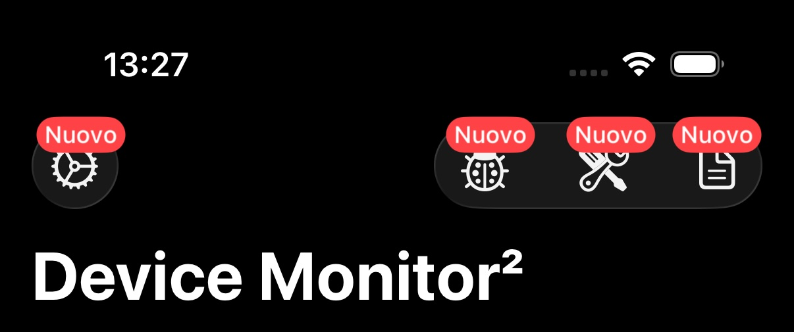
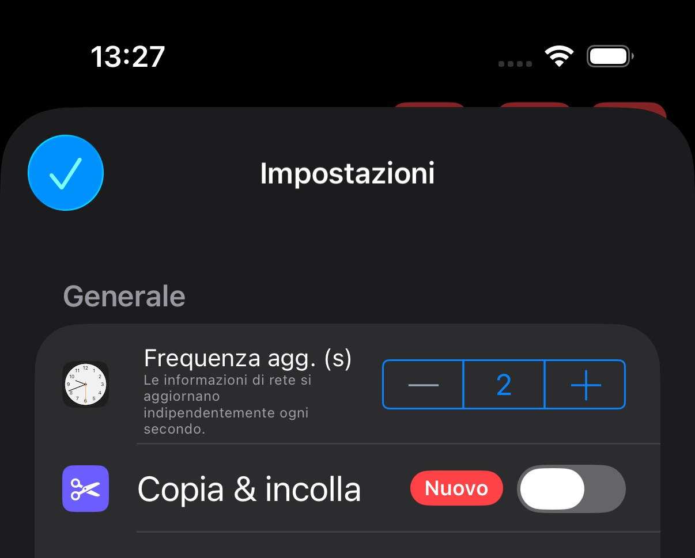

# MRBadgeDisplayCoordinator

[](https://swift.org/package-manager/)

[](https://swift.org)
[](https://developer.apple.com/xcode)
[](LICENSE)
[](https://twitter.com/FastDevsProject)

Lightweight coordinator that keeps badges in sync across multiple UI entry points. Show a badge with a single call, attach it to any `UIView` or `UIBarButtonItem`, and let the coordinator remember which ones the user already acted on — so a "new" badge can disappear automatically the first time its button is tapped.

<p align="center">
  
  
</p>

## Features

- **One-liner API**: `button.setBadge("12", id: "inbox")` schedules, shows, and auto-clears the badge on first tap.
- Coordinate one canonical badge per identifier and reuse it across any number of views.
- Attach badges to any `UIView`; `UITableViewCell` instances automatically forward to their `contentView`.
- Native `UIBarButtonItem.badge` on bar button items, custom rounded overlay on arbitrary views.
- Reused views (table cells) never inherit another row's badge — binding a view to an id detaches it from every other id.
- Choose whether the overlay hugs the top, center (default), or bottom of the view's trailing margin, per badge.
- Override the default placement with custom horizontal/vertical anchor views via `badgeAnchors` — useful when the badge should align to elements that are not the container's trailing edge (e.g. a segmented control below the title label).
- Persist badge lifecycle to `UserDefaults`, so identifiers cleared by a tap stay cleared across launches.
- **Zero third-party dependencies** — pure UIKit + AutoLayout.

## Requirements

- iOS 26.0+
- Xcode 26.0+
- Swift 6.2+

## Installation

### Swift Package Manager

Add the package to the `dependencies` array of your `Package.swift`:

```swift
dependencies: [
    .package(url: "https://github.com/furiosFast/MRBadgeDisplayCoordinator.git", from: "2.1.0")
]
```

Then add `MRBadgeDisplayCoordinator` to the target dependencies that need badge coordination.

## Getting Started

The fastest path: call `setBadge(_:id:)` on a button or bar button item. The badge appears immediately and—by default—removes itself the first time the user taps the control, while still running your own action.

```swift
import MRBadgeDisplayCoordinator

final class InboxViewController: UIViewController {
    @IBOutlet private weak var inboxButton: UIButton!

    override func viewDidLoad() {
        super.viewDidLoad()

        // Shows "12" on the button; disappears on first tap.
        inboxButton.setBadge("12", id: "inbox")
    }
}
```

That single line replaces the old schedule → attach → clear-on-action dance. Your existing `addTarget`/`UIAction` handlers keep working untouched.

## Usage

### Buttons & controls

```swift
button.setBadge("3", id: "notifications")                       // auto-clears on tap
button.setBadge("3", id: "notifications", alignment: .top)      // align to the top-trailing corner
button.setBadge("3", id: "notifications", clearsOnTap: false)   // stays until you clear it manually
```

- `clearsOnTap` defaults to `true`: the badge is removed on the control's primary action and, when persistence is configured, stays gone across launches.
- `alignment` accepts `.center` (default), `.top`, or `.bottom`.

### Bar button items

```swift
navigationItem.rightBarButtonItem?.setBadge("5", id: "messages")
```

- Configure your `target`/`action` **before** calling `setBadge`, because with `clearsOnTap: true` the coordinator wraps them to observe the tap and forwards it to your handler.
- Items created with a `primaryAction` (`UIAction`) are left untouched: clear the badge yourself from the action, or pass `clearsOnTap: false`.

### Table view cells & arbitrary views

Use `bindBadge(to:)` while configuring reusable views. It does not schedule anything — it just reflects whatever badge the coordinator currently holds for that id, and clears the view if there is none. Because each view can mirror only one id at a time, reused cells never show a stale badge.

```swift
func tableView(_ tableView: UITableView, cellForRowAt indexPath: IndexPath) -> UITableViewCell {
    let cell = tableView.dequeueReusableCell(withIdentifier: "Cell", for: indexPath)
    cell.bindBadge(to: "row-\(items[indexPath.row].id)")
    return cell
}
```

Schedule the badge for those ids wherever your data updates:

```swift
MRBadgeDisplayCoordinator.shared.schedule("•", for: "row-42")
```

### Custom placement with anchor views

By default the overlay sits at the trailing edge of the container and follows the chosen `.top` / `.center` / `.bottom` alignment on the vertical axis. When you need it to line up with a specific subview instead — for example a segmented control below the title label of a cell — assign a `BadgeAnchors` value to the target view **before** binding it:

```swift
cell.contentView.badgeAnchors = BadgeAnchors(
    horizontalAnchorView: measurementSegment,   // trailing → segment's trailing
    verticalAnchorView: titleLabel              // centerY   → label's centerY
)
cell.bindBadge(to: "row-\(item.id)")
```

- Provide only the axis you need to override; the other one falls back to the default placement.
- The anchor views are held weakly and must be descendants of the badge host, otherwise they are ignored.
- Assigning `nil` restores the default placement; changing the value while a badge is already showing re-applies the constraints live.

### Clearing badges manually

```swift
MRBadgeDisplayCoordinator.shared.clearBadge(for: "notifications")
MRBadgeDisplayCoordinator.shared.clearAll()
```

- `clearBadge(for:)` removes a specific identifier and clears every view bound to it.
- `clearAll()` wipes both state and attachments — useful on sign-out.
- Pass `shouldRemovePersistence: true` to also forget the `.removed` history (see below).

### Checking badge state

```swift
if MRBadgeDisplayCoordinator.shared.hasBadge(for: "notifications") {
    // e.g. keep a row highlighted
}

let status = MRBadgeDisplayCoordinator.shared.status(for: "notifications") // .pending / .displayed / .removed
```

## Persistence & the "show once" behaviour

Call `configurePersistence(using:)` once (for example in your app delegate) to mirror every mutation to `UserDefaults`:

```swift
let defaults = UserDefaults(suiteName: "group.com.fastdevs.badges") ?? .standard
MRBadgeDisplayCoordinator.shared.configurePersistence(using: defaults)
```

- Pending and displayed badges are restored on launch, so binding views shows the latest value immediately.
- **Once an identifier is cleared (by a tap or `clearBadge`), it is recorded as `.removed` and will not be shown again** — `schedule(_:for:)` returns early for a `.removed` id. This is what makes a "new!" badge disappear permanently after the user first interacts with it.
- To genuinely reuse the same identifier for a brand-new badge, clear it with `shouldRemovePersistence: true` first, or schedule under a different id (e.g. include a version/timestamp).

## Customising the overlay

The coordinator renders plain views with a rounded `BadgeOverlayLabel`. To restyle it, subclass and register your subclass as the overlay provider:

```swift
final class MyBadge: BadgeOverlayLabel {
    override func setUp() {
        super.setUp()
        backgroundColor = .systemBlue
        font = .boldSystemFont(ofSize: 11)
    }
}

MRBadgeDisplayCoordinator.shared.overlayProvider = { MyBadge() }
```

You can also render a badge without the coordinator by calling `showBadgeOverlay(text:alignment:)` / `removeBadgeOverlay()` directly on any `UIView`.

## Migrating from 1.x

| 1.x | 2.0 |
| --- | --- |
| `scheduleBadge(for:payload:)` + `attachBadgeIfNeeded(to:identifier:)` | `button.setBadge(_:id:)` (or `schedule(_:for:)` + `bind(_:to:)`) |
| `attachBadgeIfNeeded(to:identifier:)` | `bind(_:to:)` / `view.bindBadge(to:)` |
| manual `clearBadge` inside your tap handler | automatic via `clearsOnTap: true` |
| `clearBadge(for:shouldRemovePersistance:)` | `clearBadge(for:shouldRemovePersistence:)` *(spelling fixed)* |
| `hasBadgeScheduled(for:)` | `hasBadge(for:)` |
| SnapKit dependency | removed |

## License

MRBadgeDisplayCoordinator is released under the MIT license. See [LICENSE](LICENSE) for details.
